

  

<h1 align="center">Holler</h1>

<b>Your music, on Windows and Android.</b>

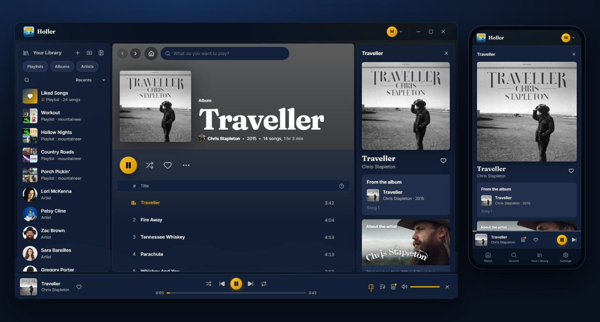

Holler is the music app for **[Seneca](https://github.com/GetHorizontal63/seneca)**, a media server you run at home. Enter your server's address, sign in, and your music is there: albums, artists, playlists and liked songs, laid out like the big streaming apps but playing your own files. Your playlists and likes are kept on the server, and the music can move between your phone, your PC, the TV and the browser.

  <a href="https://github.com/GetHorizontal63/holler/releases/latest/download/Holler-Setup.exe"><b>⬇ Windows</b></a> ·
  <a href="https://github.com/GetHorizontal63/holler/releases/latest/download/Holler.apk"><b>⬇ Android</b></a> ·
  <a href="https://github.com/GetHorizontal63/holler/releases">All releases</a> ·
  <a href="https://github.com/GetHorizontal63/seneca">Seneca (the server)</a>

| | |
|---|---|
| Latest version | see **[Releases](https://github.com/GetHorizontal63/holler/releases/latest)**; the links above always get the newest |
| Needs | a Seneca server on your network, and Windows 10 or 11 (64-bit) or Android 7.0 or newer |
| Films and TV | Holler is music only. For films, shows and Live TV, use **[Tamarack](https://github.com/GetHorizontal63/tamarack)**. On a Roku, Holler is inside Tamarack. |

---

## Contents

| | |
|---|---|
| [Install](#install) | Windows and Android, then connecting |
| [The screen at a glance](#screen) | What everything does, with pictures |
| [The player bar](#player-bar) | Every button along the bottom |
| [Using Holler](#using-holler) | Albums, artists, playlists, the queue, other devices, importing |
| [On your phone](#phone) | The same, sized for a phone |
| [Colours](#colours) | Holler's four colour schemes |
| [Updating](#updating) · [Something wrong?](#something-wrong) | |
| [For server managers](#for-server-managers) · [For developers](#for-developers) | |

---

## Install

You need a Seneca server on your network and its address, which looks like **`http://192.168.1.50:8430`**. If you run the server yourself, see [Seneca's quick start](https://github.com/GetHorizontal63/seneca#quick-start); otherwise ask whoever does.

> [!TIP]
> Nothing to install to try it: open that address in any web browser and choose **Music**. It's the same player.

| Windows | Android |
|---|---|
| 1. Download **[Holler-Setup.exe](https://github.com/GetHorizontal63/holler/releases/latest/download/Holler-Setup.exe)** and run it. 2. If Windows says the publisher is unknown (the app isn't signed with a paid certificate), press **More info → Run anyway**. 3. Holler installs and opens; it's in the Start menu from then on.  To remove it: **Settings → Apps → Installed apps → Holler → Uninstall**. | 1. On your phone, open **[Holler.apk](https://github.com/GetHorizontal63/holler/releases/latest/download/Holler.apk)**. 2. Open the downloaded file. Android asks to **allow installing unknown apps** for your browser: allow it, go back, press **Install**. 3. If Play Protect doesn't recognise the developer, press **More details → Install anyway**. |

### Connect and sign in

<table><tr>
<td width="260">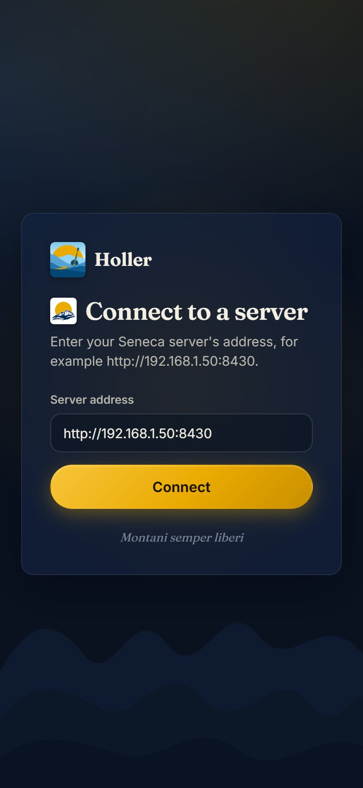</td>
<td>

1. Type the server's address in full: **`http://192.168.1.50:8430`** (the IP of the machine running Seneca, and port **8430**).
2. Press **Connect**, then sign in with your Seneca username and password.

If the address opens in a browser on the same device, Holler will connect too.

To use another server later: **Settings → Server → Change server** (on Windows also in the menu: press **Alt**).

</td></tr></table>

---

## The screen at a glance

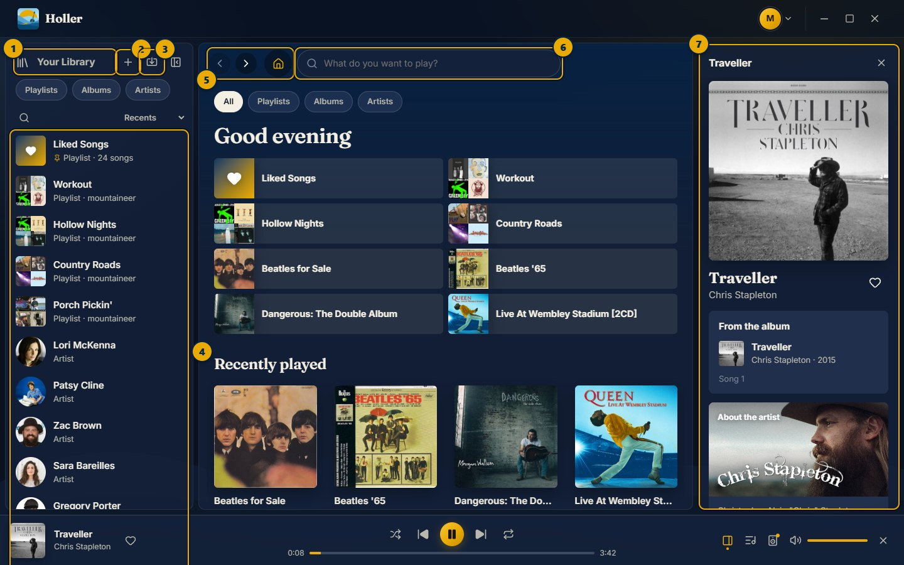

| # | What it is | What it does |
|:-:|---|---|
| 1 | **Your Library** | Click to fold the sidebar away. **Playlists**, **Albums** and **Artists** below it filter the list; the magnifier searches it, and **Recents** sorts it. |
| 2 | **+** | Start a new playlist. |
| 3 | **Import** | Bring playlists over from Spotify, or (administrators) download music from a link. |
| 4 | **Your list** | Liked Songs, your playlists, and the albums and artists you've saved. Drag songs onto a playlist here to add them. |
| 5 | **Back, forward and Home** | Home has your quick picks, recently played, playlists, new releases and artists. |
| 6 | **Search** | Songs, albums and artists, as you type. |
| 7 | **Now playing** | The song, its album, and *About the artist*. The button at the bottom right switches between this and the queue. |

The window has no title bar: drag the header to move it. The buttons at the top right are minimise, maximise and close.

### The player bar

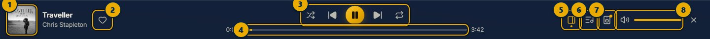

| # | | |
|:-:|---|---|
| 1 | **The song** | Click the cover to open its album; the name or artist to go to them. |
| 2 | **Like** | Adds it to **Liked Songs**. |
| 3 | **Shuffle · Previous · Play/Pause · Next · Repeat** | Repeat goes off → all → one. |
| 4 | **Position** | Drag to jump. |
| 5 | **Now playing** | The panel on the right (7 above). |
| 6 | **Queue** | What's playing next. Click a song to jump to it; **×** takes one out. |
| 7 | **Play on another device** | Move the music to your phone, PC, TV or a browser ([below](#devices)). |
| 8 | **Volume** | Click the speaker to mute. |

The music keeps playing while you browse anywhere. Songs follow one another with no gap, and formats your device can't decode are converted by the server as they play.

---

## Using Holler

### Albums and artists

| An album | An artist |
|---|---|
| 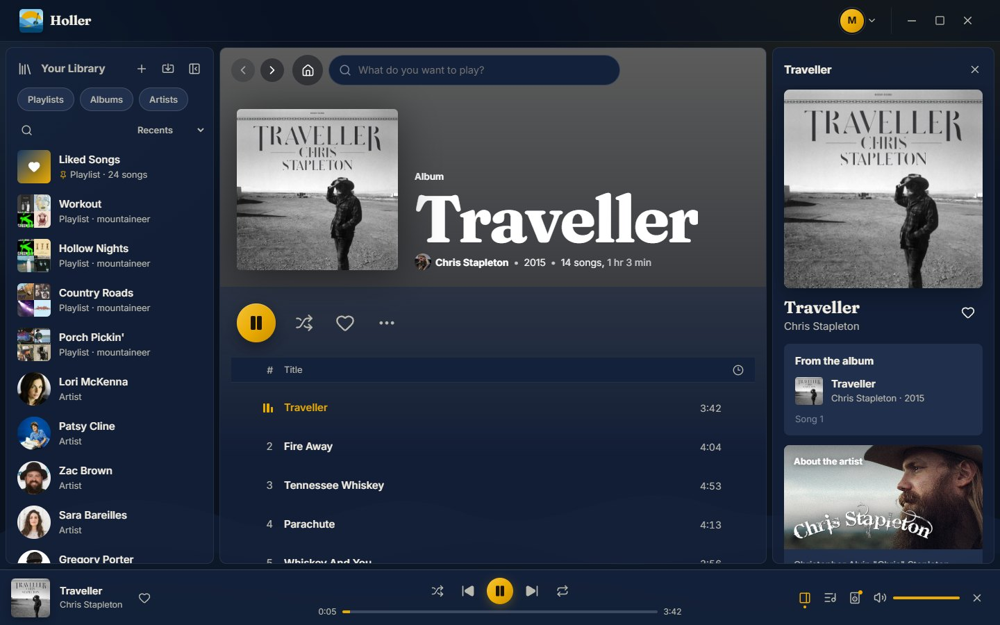 | 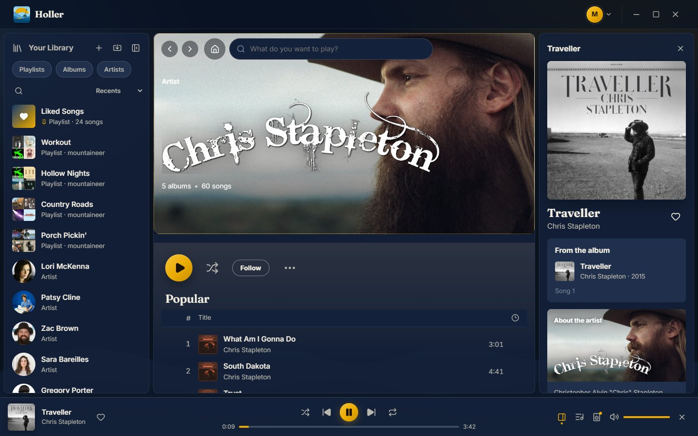 |
| **Play** (the big button), **Shuffle**, the heart to **save it** to your library, and **⋯** for more (add to a playlist or the queue). Click any song to play from there. | The band's picture, logo and a short biography when the server can find them online, their popular songs and albums, and **Appears on** for songs they're featured in. |

### Playlists

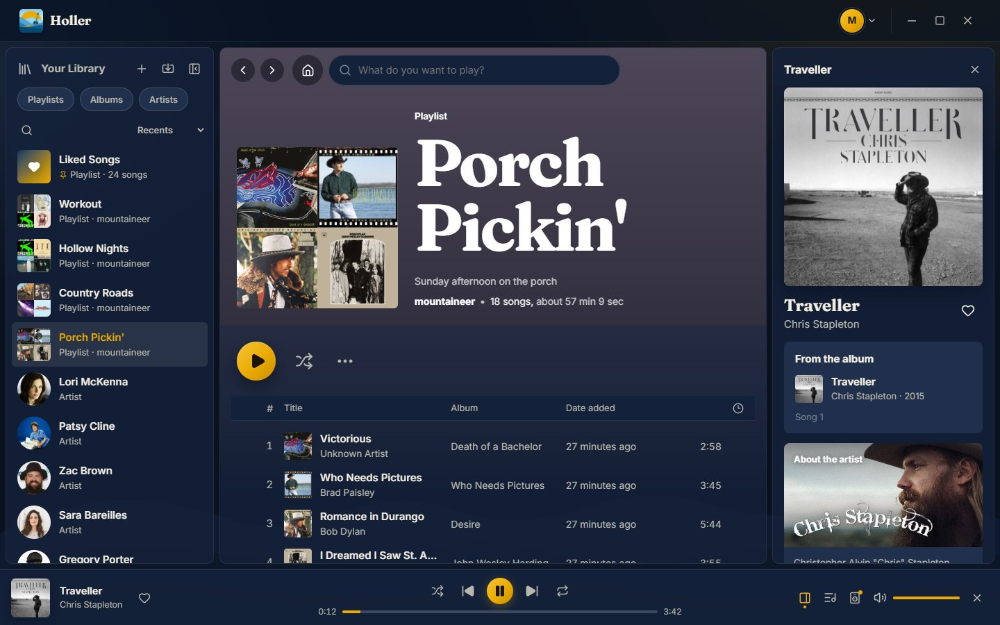

- **Start one** with **+** next to *Your Library*.
- **Add songs:** right-click (long-press on a phone) a song, album or artist → **Add to playlist**, or drag songs onto a playlist in the sidebar.
- **Inside a playlist:** drag songs to change the order; right-click to take one out; click the name or cover to rename it.
- Playlists are yours alone: other people on the server don't see them.

### The queue

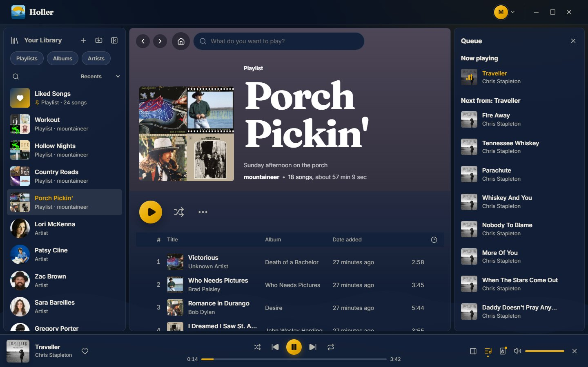

**Queue** (6 on the player bar) shows what's playing now and next. Click a song to jump to it; the **×** takes one out. Right-click any song, album or playlist → **Add to queue** to slip it in after the current song.

### Play on another device, control it from this one

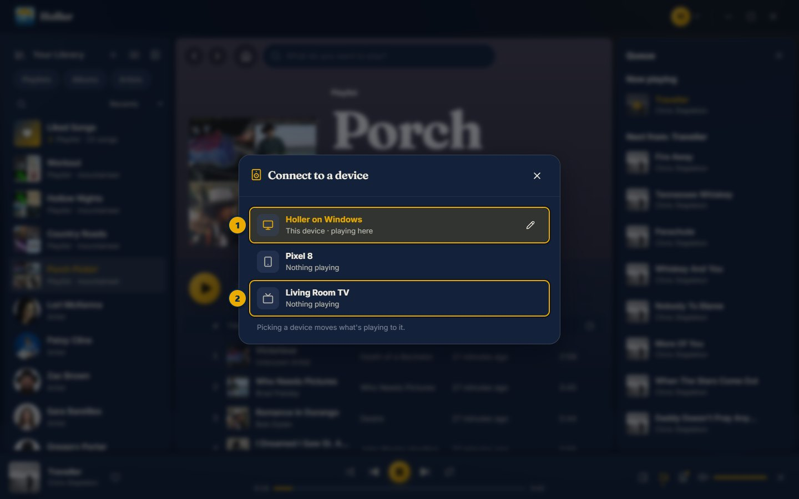

Every place you listen, signed in as you, shows up here: Holler on a phone or PC, Tamarack on a Roku, or the music section in a browser.

| # | | |
|:-:|---|---|
| 1 | **This device** | Where it's playing now. The pencil renames it. |
| 2 | **Another device** | Pick it and the music moves there, at the same point in the song. |

When nothing is playing here, Holler shows what your other device is playing, with all its controls: play, pause, skip, seek, volume, shuffle, repeat and the queue. Choosing an album or playlist then plays it *there*. If a browser hasn't been touched yet it may refuse to start sound on its own; Holler says so, and one tap on play there fixes it.

### Bringing music in

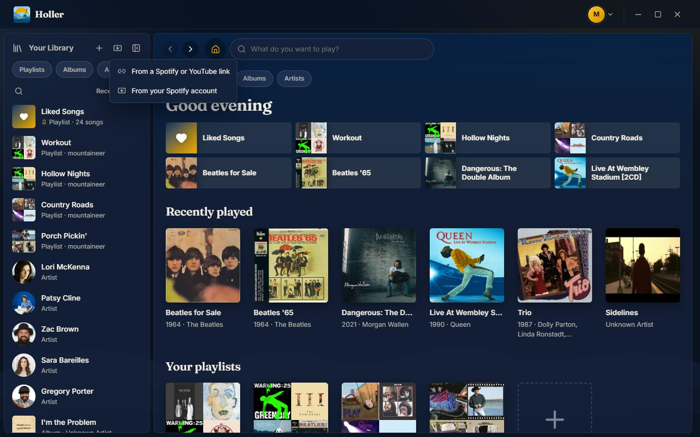

- **From your Spotify account:** connect Spotify and tick the playlists you want. Each becomes a playlist here, with the songs your library has, in the same order. Its page lists what's missing and has **Sync now**; with **Follow the Spotify playlist** on, changes on Spotify arrive within a few hours. The server's administrator sets this up once, and Spotify allows at most five people per server.

  > Spotify only sends you back to `https://` addresses. If its last page says it "can't be reached", copy that page's address and paste it into Holler. Holler explains as you go.

- **From a Spotify or YouTube link** (administrators): paste a link to a playlist, album or song. Holler shows how many of its songs the library has, and **Download** fetches the rest, tagged and with covers. Everyone can play them once they're in.

---

## On your phone

| Home | An album | Now playing | Your Library |
|---|---|---|---|
| 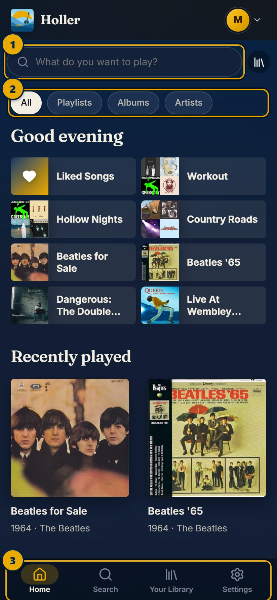 |  |  | 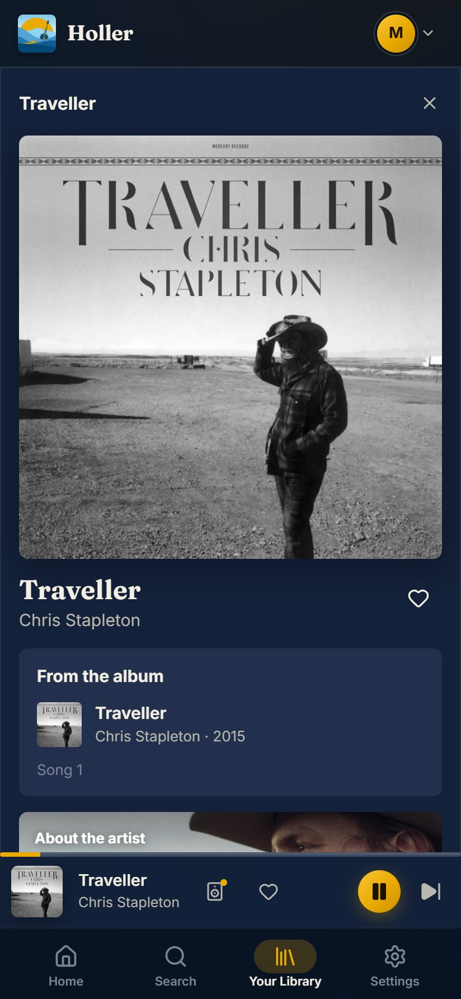 |

| # | | |
|:-:|---|---|
| 1 | **Search** | What do you want to play? The button beside it opens your library. |
| 2 | **Filters** | All, Playlists, Albums or Artists. |
| 3 | **Tabs** | Home, Search, Your Library and Settings. |

The mini player sits above the tabs while music plays: tap the cover for **Now playing**, the speaker for other devices, the heart to like it. **Back** (button or gesture) closes what's open, then goes back a screen.

> [!NOTE]
> Holler on Android doesn't have lock-screen or notification controls yet, and Android may stop the music once Holler has been in the background for a while. For long listening keep it open, or use the Windows app or a browser.

---

## Colours

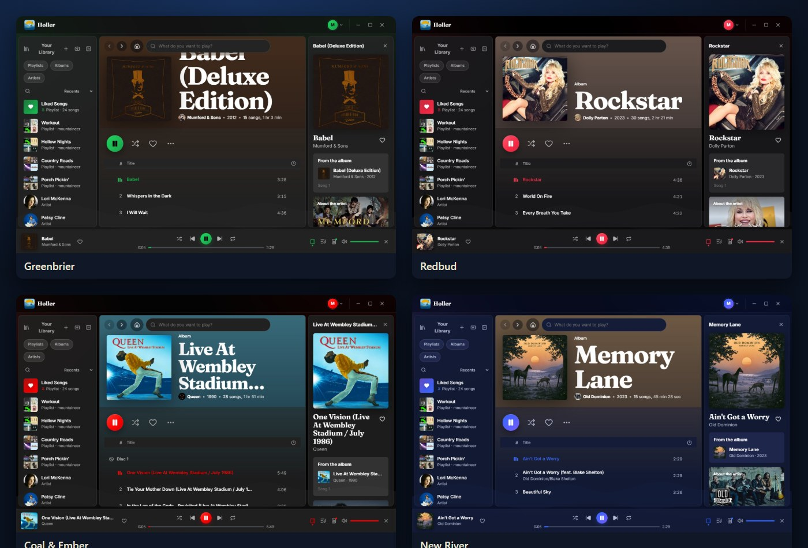

**Settings → Appearance** has Holler's own four schemes, each with its own backgrounds: **Greenbrier** (green on near-black), **Redbud** (pink-red on black or white), **Coal & Ember** (red on deepest black) and **New River** (blue to violet on navy), as well as Seneca's three palettes, in dark, light or match-the-system. It's saved per device.

---

## Updating

Holler tells you when there's a new version and installs it itself. Nothing is lost: your sign-in stays, and your playlists and likes are on the server.

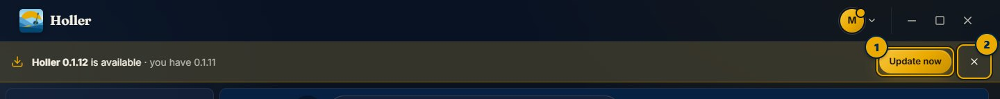

<table><tr>
<td width="260">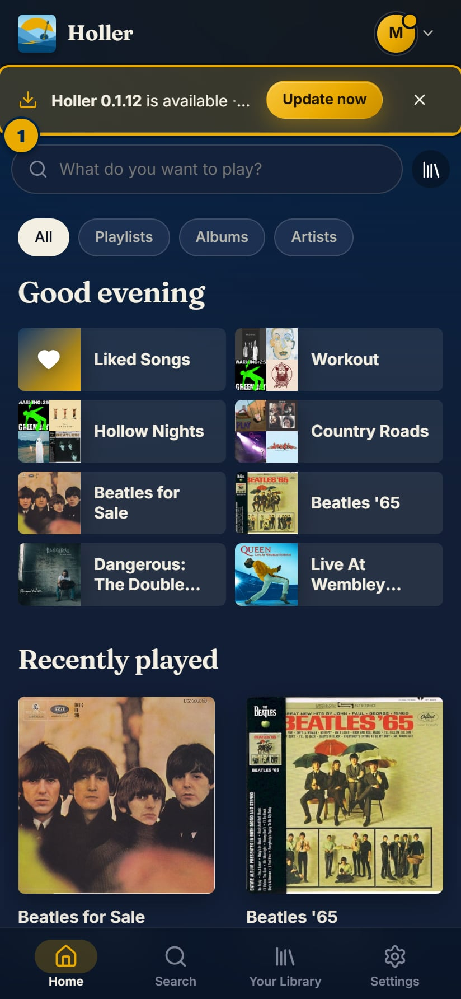</td>
<td>

| | |
|---|---|
| **Windows** | **1 Update now**. It downloads, installs and opens again. **2 ✕** hides the bar until the next version. |
| **Android** | **Update now**. The first time, Android opens **Allow from this source**: turn it on, come back, and press **Update now** again. Then **Update** when Android asks. |

**Settings → App updates** shows your version and checks again.

</td></tr></table>

No update ever shows up? The server you're on can't see the releases: tell whoever runs it (it's [In-app updates](https://github.com/GetHorizontal63/seneca#in-app-updates) in Seneca's README). You can always install the newest version over the old one from the links at the top.

---

## Something wrong?

### 1. "Failed to fetch" or "can't be reached" when connecting

1. Open the same address in a browser **on that device**. If it doesn't load there either, it's the network, not the app.
2. Check the device is on your home Wi-Fi, not mobile data.
3. Use the server's **IP address** (`192.168.…`), not a name like `truenas.local`, and include the port: `:8430`.

### 2. "It isn't a Seneca server"

Something answered, but not Seneca. Check the port: Seneca uses **8430** unless it was changed.

### 3. No music, or a song or album is missing

The server may have no music library yet, its first scan may not have finished, or the files aren't tagged. Ask the administrator to scan the library.

### 4. The music stops when the phone is locked

Android stopped Holler in the background (see the note under [On your phone](#phone)). Open Holler and press play.

### 5. My other device isn't in the speaker list

It must be signed in as **you**, to the same server, with Holler, Tamarack for Roku or the browser's music section open. A phone that's been in the background a while drops off: open the app there.

### 6. "Tap play there once"

The other device is a browser that won't start sound on its own. Press play on it once; from then on it can be controlled.

### 7. Spotify import: a playlist is greyed out, or Spotify's last page "can't be reached"

Spotify only shares playlists you made or collaborate on: in Spotify, add its songs to a new playlist of your own and import that. The "can't be reached" page is expected on a home server: paste its address into Holler.

### 8. Android won't install an update ("App not installed")

Your copy was signed differently. Uninstall Holler and install the new one; you only need to connect and sign in again.

### 9. Windows: "Windows protected your PC"

**More info → Run anyway.** The app isn't signed with a paid certificate.

---

## For server managers

Holler needs Seneca and a **Music** library. Some features need a one-time setup in **Administration → Server**:

| Feature | What it needs | Details |
|---|---|---|
| Playing music | a **Music** library; tagged files (artist, album, track number) | [Naming your files](https://github.com/GetHorizontal63/seneca#naming) |
| Spotify playlist import | a Spotify developer app (its owner needs Premium), its Client ID, each person's Spotify email allowlisted; at most 5 people | [Spotify](https://github.com/GetHorizontal63/seneca#spotify) |
| Import from links | *Downloads from links* on, and a music folder the server can **write** to (no `:ro` in Docker) | [Downloads from links](https://github.com/GetHorizontal63/seneca#downloads) |
| Band pictures and biographies | online artwork left on (only band names go to TheAudioDB) | [Naming your files](https://github.com/GetHorizontal63/seneca#naming) |
| In-app updates | if this repository is private, `SENECA_GITHUB_TOKEN` (a read-only token, *Contents: Read-only* on `tamarack` and `holler`) | [In-app updates](https://github.com/GetHorizontal63/seneca#in-app-updates) |

Playing between devices needs no setup. Formats a device can't decode (WMA, APE…) are converted as they play, which costs a little CPU per listener.

## For developers

This repository holds only releases. The source is **[Seneca](https://github.com/GetHorizontal63/seneca)**:

| Part | In Seneca | |
|---|---|---|
| The app | `web/` | the browser client built with `vite build --mode holler`: music only, opening in the player (`web/src/edition.ts`) |
| The player | `web/src/music/` | section, queue and bar (`player.tsx`), Connect (`connect.tsx`), Spotify and link import |
| Windows shell | `apps/desktop/` | Electron: loads the build from disk, draws its own window buttons, runs updates quietly |
| Android shell | `apps/android/` | Capacitor, patched by `patch-android.cjs`; `native/` has back handling and the update installer |
| Server side | `server/src/routes/music.ts`, `connect.ts`, `spotify.ts`, `links.ts` | browsing, Connect, imports |
| This page | `apps/holler/` | `README.md`, `img/`, and the icon from `apps/icons/holler.png` |

To try changes without building: `npm run dev:server` and `npm run dev:holler --prefix web`, then `http://localhost:5174`. Builds and releases use `build_apps.py` and `push.py` ([Seneca's developer section](https://github.com/GetHorizontal63/seneca#for-developers), including the Android signing key). Each release attaches `Holler.apk` and `Holler-Setup.exe` under the same names every time; Seneca's update check depends on them.

Holler · for Seneca · almost heaven

